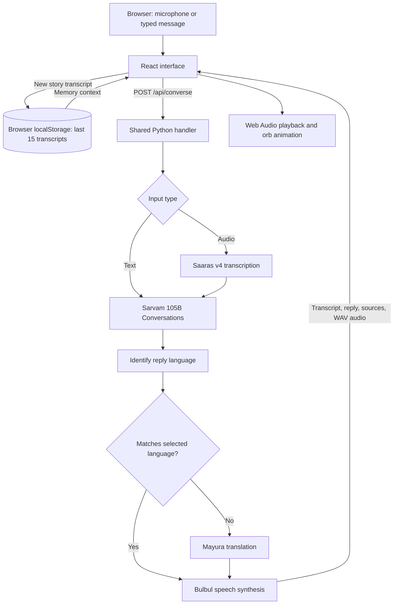

# Yaad — a voice time capsule powered by Sarvam AI

Tell a memory in your own language. Ask about it later. Hear the reply in the language you choose.

Yaad is a responsive hackathon prototype for recording personal stories and exploring them through conversation. It combines Sarvam speech recognition, conversational AI, language identification, translation, and speech synthesis in one screen, with an audio-reactive silver orb and a guided first-visit tutorial.

**[Open Yaad](https://yaad-ui.vercel.app/) · [Open the judge walkthrough](https://yaad-ui.vercel.app/?tour=1)**

> Current scope: the last 15 story transcripts are saved in the current browser. Yaad does not provide permanent original-audio archiving, family voice cloning, accounts, or cross-device synchronization. Spoken replies use a stock AI narrator.

## Contents

- [What you can do](#what-you-can-do)
- [Judge walkthrough](#judge-walkthrough)
- [Architecture](#architecture)
- [Sarvam integrations and languages](#sarvam-integrations-and-languages)
- [Code structure](#code-structure)
- [Run locally](#run-locally)
- [API reference](#api-reference)
- [Deployment](#deployment)
- [Verification and troubleshooting](#verification-and-troubleshooting)
- [Data handling and limitations](#data-handling-and-limitations)
- [Attribution](#attribution)

## What you can do

- **Tell a story:** record a short memory or type it. Yaad saves the transcript and asks a follow-up based on what you shared.
- **Ask my capsule:** ask questions about saved memories. Supported answers can show an expandable **Original memory** transcript.
- **Choose a reply language:** speak in one language and request the response in another. Input speech recognition uses automatic language detection.
- **Hear the response:** play, pause, and replay generated speech. The orb reacts to microphone input and reply playback.
- **Use the app across devices:** the interface adapts to phones, tablets, laptops, and landscape layouts.
- **Learn through the interface:** the tutorial highlights actual controls, supports Back/Skip, and respects reduced-motion preferences.
- **Manage the current browser's memories:** use the more menu to clear saved transcripts, switch to typing, replay the tutorial, or download the currently available audio clip.

## Judge walkthrough

Start with **[this link](https://yaad-ui.vercel.app/?tour=1)** to explicitly open the tutorial. A normal first visit opens it automatically; subsequent visits remember dismissal or completion in that browser. Replay it from **••• → Take a guided tour**.

Use this **synthetic test memory**:

> When I was eight, my grandfather taught me to ride a bicycle in Pune. We celebrated with mango ice cream.

| Step | Action | Expected behavior |
| --- | --- | --- |
| 1 | Choose a reply language, such as Hindi or Marathi. | The selection controls the language of subsequent answers and speech. |
| 2 | Select **Tell a story**, tap the microphone, say the sample, then tap stop. | Yaad transcribes it, saves the transcript, and returns a spoken follow-up. Recording stops automatically at 25 seconds. |
| 3 | If sound does not start, tap **Play answer** or the headphones control. | The generated reply plays; the orb reacts to the audio. |
| 4 | Select **Ask my capsule** and ask “Who taught me to ride a bicycle?” | The answer should identify your grandfather and provide a source transcript. |
| 5 | Ask “What was my grandfather's first salary?” | The answer should explain that this detail has not been recorded. |
| 6 | Change the reply language and ask “Where did I learn to ride?” in English. | The reply should mention Pune in the newly selected language. |
| 7 | Reload the page in the same browser. | Saved transcripts remain available. |

The keyboard control or **••• → Type instead** provides a typed alternative when microphone access is unavailable. Typing skips speech recognition but still uses the real Sarvam backend for replies and speech. The tutorial's **Try example** action only prefills the text field; press **Send** to process and save it.

These are expected behaviors to verify, not a guarantee of model accuracy. Inspect the source transcript when evaluating an answer.

## Architecture



The frontend sends the current message, selected output language, mode, and saved transcript context to the backend. In **record** mode, the model acknowledges the story and asks one follow-up. In **ask** mode, its instructions restrict answers to supplied memories and request supporting memory IDs.

The backend checks that returned source IDs exist in the supplied archive. This is an ID check, not an independent verification that every claim is supported. The model can still make mistakes.

Generated replies are language-checked and translated when the detected language differs from the selection. Speech synthesis first uses Bulbul v3, with a second attempt using Bulbul v4 Flash for configured languages or another v3 attempt otherwise. If synthesis fails, the text reply is still returned with a warning.

Locally, Vite forwards `/api` requests to the Python server. On Vercel, small Python function adapters reuse the same handler beside the static frontend.

### Technology stack

| Layer | Implementation |
| --- | --- |
| Interface | React 19, TypeScript, Vite 7, Lucide icons |
| Orb | Three.js, React Three Fiber, Drei, adapted ElevenLabs UI orb |
| Recording | Browser `getUserMedia` and `MediaRecorder` |
| Playback and audio levels | Web Audio API and analyser nodes |
| Styling | Custom CSS, translucent glass controls, responsive layouts |
| Backend | Python standard-library HTTP handler and official `sarvamai` SDK |
| Persistence | Browser `localStorage`; no application database |
| Hosting | Vercel static frontend and Python functions |

The interface does **not** call an ElevenLabs API. The orb is a visual component; Sarvam generates the responses and speech.

## Sarvam integrations and languages

| Purpose | SDK call | Model / behavior |
| --- | --- | --- |
| Speech recognition | `client.speech_to_text.transcribe` | `saaras:v4`, automatic input-language detection |
| Interviewing and memory questions | `client.chat.completions` | `sarvam-105b-conversations`, structured JSON response |
| Reply-language check | `client.text.identify_language` | Checks the generated reply's language |
| Conditional translation | `client.text.translate` | `mayura:v1`, native-script output |
| Spoken reply | `client.text_to_speech.convert` | `bulbul:v3`, WAV output; configured fallback to `bulbul:v4-flash` |

The current output-language selector exposes:

| Language | Code | Language | Code |
| --- | --- | --- | --- |
| English | `en-IN` | Hindi | `hi-IN` |
| Marathi | `mr-IN` | Bengali | `bn-IN` |
| Tamil | `ta-IN` | Telugu | `te-IN` |
| Gujarati | `gu-IN` | Kannada | `kn-IN` |
| Malayalam | `ml-IN` | Punjabi | `pa-IN` |
| Odia | `od-IN` | | |

The v4 Flash fallback has configured voices for all of these except Malayalam and Odia, which retry v3. Input-language detection and output-language selection are separate: the selector does not force the language you must speak.

## Code structure

```text
Sarvam-Yaad/
├── src/
│   ├── main.tsx             # React entry point
│   ├── App.tsx              # Main screen, recording, requests, memories, playback
│   ├── GuidedTour.tsx       # Guided steps, spotlight positioning, keyboard handling
│   ├── Orb.tsx              # Audio-reactive Three.js orb
│   ├── style.css            # App layout, glass styling, responsive rules
│   ├── tour.css             # Tutorial overlay, transitions, reduced-motion styles
│   └── utils.ts             # Class-name utility
├── public/
│   └── perlin-noise.png     # Bundled orb texture
├── api/
│   ├── converse.py          # Vercel adapter for the conversation handler
│   └── health.py            # Vercel adapter for the health handler
├── server.py               # Shared API logic and local Python server
├── sarvam_check.py         # Standalone real chat API check
├── requirements.txt        # Python SDK dependency
├── package.json            # Frontend dependencies and scripts
├── package-lock.json       # Frontend dependency lockfile
├── vite.config.ts          # Dev server and local API proxy
├── tsconfig.json           # TypeScript configuration
├── index.html              # HTML entry point
├── vercel.json             # Build output and Python function configuration
├── .python-version         # Deployment Python version: 3.12
├── .env.example            # API-key variable template, no credential
├── .gitignore              # Excludes secrets, dependencies, build artifacts
├── .vercelignore           # Excludes local files from deployment uploads
├── ELEVENLABS-LICENSE.md    # License for the adapted orb component
└── README.md
```

### Where to make changes

- **User flow, language choices, memory handling, or playback:** start in [`src/App.tsx`](src/App.tsx). It owns the recording/request/playback states and browser persistence.
- **Tutorial copy and interaction:** edit [`src/GuidedTour.tsx`](src/GuidedTour.tsx), [`src/tour.css`](src/tour.css), and the corresponding `data-tour` targets in `App.tsx`.
- **Layout or glass appearance:** edit [`src/style.css`](src/style.css). Orb rendering lives in [`src/Orb.tsx`](src/Orb.tsx).
- **Models, prompts, validation, language enforcement, or speech fallbacks:** edit [`server.py`](server.py). Both local development and Vercel use this implementation.
- **Hosting settings:** edit [`vercel.json`](vercel.json). The adapters in `api/` contain no separate conversation workflow.

## Run locally

### Prerequisites

- Node.js **22.12 or newer** within a Vite-compatible release, and npm.
- Python **3.12** recommended to match deployment.
- A Sarvam API key with access and credits for the configured services.
- A modern browser with WebGL; microphone mode additionally requires recording support and permission.

### 1. Install dependencies

```bash
git clone https://github.com/Soham-commits/Sarvam-Yaad.git
cd Sarvam-Yaad
npm ci
python3 -m venv .venv
.venv/bin/python -m pip install -r requirements.txt
```

### 2. Configure the server key

For a fresh clone, copy the template:

```bash
cp .env.example .env
```

Open `.env` and fill in `SARVAM_API_KEY=` with your own key. Do not overwrite an existing `.env`. The backend also accepts an environment variable directly; an existing environment value takes precedence over the file.

Keep the key server-side. `.env` is ignored by Git; never place the key in React code or a `VITE_` variable, which would expose it in the browser bundle.

### 3. Start both servers

Terminal 1 — backend:

```bash
.venv/bin/python server.py
```

Terminal 2 — frontend:

```bash
npm run dev
```

Open **http://localhost:5173** and keep both terminals running. The backend listens at `127.0.0.1:8000`; Vite proxies `/api` to it.

On Windows, use `.venv\Scripts\python.exe` instead of `.venv/bin/python`, and `Copy-Item .env.example .env` in PowerShell instead of `cp`.

For a physical phone, use the deployed HTTPS app. An ordinary HTTP LAN address generally cannot access the microphone because browsers require a secure context; `localhost` is the local-development exception.

### Available commands

| Command | Purpose |
| --- | --- |
| `npm run dev` | Start the Vite development server with the API proxy |
| `npm run build` | Run TypeScript checking and produce the frontend in `dist/` |
| `npm run preview` | Preview the built static frontend; does **not** provide the development API proxy |
| `.venv/bin/python server.py` | Start the local backend |
| `.venv/bin/python sarvam_check.py` | Make one real chat request and print the reply |

The standalone check requires a configured key and consumes API usage. It verifies the chat integration only, not speech recognition, translation, or synthesis. No automated test suite is configured in this repository.

## API reference

### `GET /api/health`

Returns:

```json
{
  "ready": true,
  "model": "sarvam-105b-conversations"
}
```

This confirms that the handler loaded with a configured key. It does **not** contact Sarvam or verify key validity, model access, or remaining credits.

### `POST /api/converse`

Send JSON. This typed example asks about a synthetic supplied memory:

```json
{
  "mode": "ask",
  "language": "hi-IN",
  "text": "Where did I learn to ride a bicycle?",
  "memories": [
    {
      "id": "demo-memory-1",
      "text": "My grandfather taught me to ride a bicycle in Pune."
    }
  ]
}
```

| Field | Meaning |
| --- | --- |
| `mode` | `record` for a story/follow-up; `ask` for archive questions. Defaults to `record`. |
| `language` | Output-language code from the supported list. Invalid values fall back to `en-IN`. |
| `text` | Typed input. A nonempty value takes precedence over audio; limited to 3,000 characters. |
| `audio` | Base64-encoded audio bytes, without a data-URL prefix, when not supplying text. |
| `mime` | Recording MIME type, such as `audio/webm` or `audio/mp4`. |
| `memories` | Array of `{id, text}` objects. The handler uses the last 15 and bounds the prompt context. |

Successful responses contain:

| Field | Meaning |
| --- | --- |
| `transcript` | Recognized speech or submitted text |
| `reply` | Generated answer in the selected output language |
| `audio` | Base64 WAV speech, or `null` when speech generation fails |
| `sources` | Supporting memory IDs returned by the model and filtered against supplied IDs |
| `warning` | Speech-generation warning, or `null` |
| `language` | Output-language code |
| `elapsed` | Backend processing time in seconds |

The handler limits incoming request bodies to 12,000,000 bytes; the browser additionally caps recording at 25 seconds. Hosting-platform limits can be lower. Empty input and unrecognized speech have error responses; upstream failures generally return HTTP `502` with an `error` message. Speech-synthesis failure alone can return HTTP `200` with text and a warning, so clients should inspect both `audio` and `warning`.

## Deployment

The app is configured for Vercel:

1. Import this repository into a Vercel project.
2. Add **`SARVAM_API_KEY`** in the project's server environment variables for the environments you use. Do not upload a local `.env` or commit a key.
3. Use the repository's configuration: Vite framework, `npm run build`, and `dist` output.
4. Deploy. If changing environment variables afterward, redeploy to apply them.
5. Open the HTTPS URL and complete the voice and typed checks below.

[`vercel.json`](vercel.json) configures the Python functions with a 60-second maximum duration. The full voice pipeline makes several upstream calls, so processing time depends on Sarvam and platform limits; no latency guarantee is made.

The existing live project is connected to GitHub `main` for production deployments. The local Python process is not needed by the deployed site. For a new deployment, browser memories start empty because storage is scoped to the site's origin.

## Verification and troubleshooting

### Manual checks

Before sharing a deployment, check the actual user flow:

- Open `?tour=1`; verify each highlighted control and the sample-text action.
- Send a typed story; confirm a reply and persistence after reload.
- Record a story; verify the transcript, audio playback, and orb response.
- Ask a question with a known answer and inspect **Original memory**.
- Ask for an absent detail; confirm the reply acknowledges the gap.
- Change output language while keeping input in another language; check text **and** speech.
- Pause/replay audio; try the visible **Play answer** control on a phone.
- Check narrow phone, tablet, and laptop layouts; confirm controls remain usable.
- Clear test memories from the more menu after testing.

### Common issues

| Symptom | What to check |
| --- | --- |
| Microphone does not open | Use HTTPS or localhost, allow browser/OS microphone access, and check recording support. Use the typed alternative if needed. |
| Reply text appears without sound | Tap **Play answer**, check device volume/output, and inspect any speech-service warning. Browser autoplay restrictions may require a tap. |
| No reply or an API error | Check backend availability, Sarvam model access, credits, and server-side key configuration. A successful health response alone is insufficient. |
| Local `/api` calls fail | Keep the Python server running on port 8000 and use the Vite development server on port 5173. Static preview does not include the dev proxy. |
| Memories are missing on another device or URL | Transcripts belong to the current browser and origin. Localhost, the deployed domain, private browsing, and other devices have separate storage. |
| Tutorial no longer opens automatically | Use `?tour=1` or **••• → Take a guided tour**. The first-visit marker is `yaad-guided-tour-v1`. |
| A reply takes too long | Retry with a shorter recording or typed input. The browser waits up to 120 seconds, but deployment function limits may expire sooner. |

## Data handling and limitations

- **Browser persistence:** `yaad-memories` holds up to 15 story transcripts in `localStorage`. Clearing site data or using another browser can remove or separate access to them. There is no backup or synchronization service.
- **External processing:** audio, current text, and supplied memory context are sent through the backend to Sarvam as needed to fulfill the request. Browser-local storage does not mean processing happens entirely on-device.
- **Audio scope:** original recordings are not durably archived. Audio is held temporarily in the page. After successful speech generation, the download control saves the generated reply; if processing has not replaced a microphone recording with a reply, the available clip can still be that recording. There is no historical audio collection.
- **Narrator identity:** speech is synthesized with standard AI voices. Yaad does not reproduce a family member's voice or impersonate a deceased relative.
- **Answer reliability:** prompt instructions and source-ID filtering support grounded answers but cannot eliminate incorrect statements. Transcription and language identification can also be wrong.
- **Public-demo scope:** there are no application accounts, server-side user archives, access controls, or app-level rate limiting. Public requests use the deployment owner's Sarvam account and credits. Add these controls before broader production use.
- **Connectivity:** generation requires internet access and available upstream services. This is a working prototype, not a production archival service.

## Attribution

The orb in [`src/Orb.tsx`](src/Orb.tsx) is adapted from the [ElevenLabs UI](https://github.com/elevenlabs/ui) component, with a silver palette and bundled texture. Its MIT license is retained in [`ELEVENLABS-LICENSE.md`](ELEVENLABS-LICENSE.md). This attribution does not declare a repository-wide license for the rest of Yaad.

AI processing uses the official Sarvam SDK. See the [Sarvam documentation](https://docs.sarvam.ai/api/getting-started/welcome) for service access and API details. Supported models and behavior documented above reflect the implementation in this repository.
