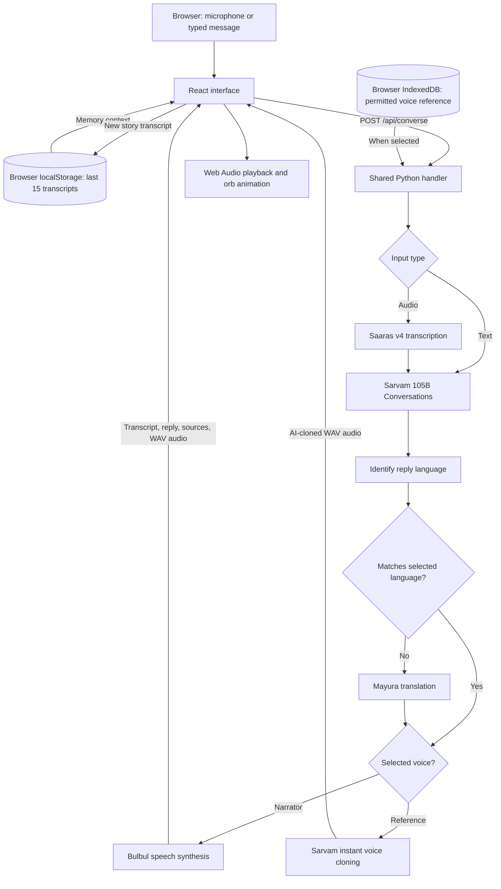

# Yaad — a voice time capsule powered by Sarvam AI

Tell a memory in your own language. Ask about it later. Hear the reply in the language you choose.

Yaad is a responsive hackathon prototype for preserving a familiar voice and using it to speak new stories, poems, and conversational replies. It combines Sarvam speech recognition, conversational AI, language identification, translation, and speech synthesis in one full-screen orb experience, with an audio-reactive silver orb and a guided first-visit tutorial.

**[Open Yaad](https://yaad-ui.vercel.app/) · [Open the judge walkthrough](https://yaad-ui.vercel.app/?tour=1)**

> Current scope: the last 15 story transcripts are saved in the current browser. Yaad does not provide permanent story-audio archiving, accounts, or cross-device synchronization. Record a short, permitted voice reference through the orb for real Sarvam voice cloning. The app requires a saved voice before generating replies. Cloned output is labelled as AI-generated.

## Contents

- [What you can do](#what-you-can-do)
- [Judge walkthrough](#judge-walkthrough)
- [Architecture](#architecture)
- [Sarvam integrations and languages](#sarvam-integrations-and-languages)
- [Code structure](#code-structure)
- [Run locally](#run-locally)
- [API reference](#api-reference)
- [Deployment](#deployment)
- [Verification and troubleshooting](#verification-and-troubleshooting)
- [Data handling and limitations](#data-handling-and-limitations)
- [Attribution](#attribution)

## What you can do

- **One orb, one screen:** preserve a voice, ask a question, or hear new content without switching between memory and conversation tabs. The main viewport does not scroll.
- **Preserve a voice directly:** tap the orb, confirm permission, then speak clearly for 10–12 seconds. Tap again to save, or let recording finish automatically. No upload is needed.
- **Talk in the saved voice:** subsequent questions use the same reference. A new question never replaces the voice. Ask for a poem, story, or an answer about a saved memory.
- **Use the bottom dock:** microphone mute, start/end session, explicit text-input toggle, and new session stay above the device's bottom safe area. Starting fresh keeps saved stories, voice, and archived history.
- **Hear replies first:** no full answer textbox appears. Optional subtitles reveal small chunks as the reply plays. Timing is estimated from audio progress, not provider word timestamps or live model-token streaming.
- **Open the circular hamburger menu:** seven spring-animated, glass shortcuts open History, Voice, Privacy, Settings, Save story, Hear poem, and Guide. Labels stay visible on phones; secondary panels keep their existing controls.
- **Keep secondary features in the hamburger menu:** unified conversation/memory history, voice naming and re-recording, privacy/data controls, reply language, subtitle preferences, and hands-free settings.
- **Save stories intentionally:** use **Menu → Save a story**, then speak or type. These are separate from the reusable voice reference.

## Judge walkthrough

Open **[Yaad](https://yaad-ui.vercel.app/)**, or use **[the guided link](https://yaad-ui.vercel.app/?tour=1)** to show the short three-step tutorial. Replay it from **Menu → Quick guide**.

| Step | Action | Expected behavior |
| --- | --- | --- |
| 1 | Tap the central orb. | The voice-permission prompt appears when no reference is saved. |
| 2 | Confirm permission and choose **Record with the orb**. Speak naturally for 10–12 seconds. | The orb reacts to the microphone. Tap again to save, or let the 12-second limit stop recording. Short or very quiet clips are rejected. |
| 3 | Tap the same orb and request “Recite Twinkle, Twinkle, Little Star.” | Sarvam generates new speech using the saved reference. The original recording is not simply replayed. |
| 4 | Alternatively, choose **Menu → Hear Twinkle, Twinkle**. | The complete public-domain first stanza is spoken in the selected language and saved voice. |
| 5 | Watch the optional subtitles while the reply plays. | Small chunks follow audio progress. No keyboard or complete answer card opens automatically. |
| 6 | Use mute/unmute and end-session controls in the bottom dock. | Microphone input can pause without replacing the voice reference; ending stops the current interaction. |
| 7 | Open **Menu → System settings** and change the reply language or subtitle preference. | The preference applies to subsequent replies and is retained in this browser. |
| 8 | Reload the same browser and origin. | Voice, saved stories, settings, and the last 40 conversation messages remain available. |

Use your own voice or one you have permission and rights to clone. Cloning approximates a voice; it does not guarantee an identical reproduction or recreate the person's thoughts.

To test memory questions, choose **Menu → Save a story** and submit this synthetic example:

> When I was eight, my grandfather taught me to ride a bicycle in Pune. We celebrated with mango ice cream.

Then ask the orb who taught you, where it happened, and what your grandfather's first salary was. Answers should use saved context and acknowledge absent details. Read the conversation and original stories inside **Menu → Conversation & memory history**. These are expected behaviors to verify, not a guarantee of model accuracy.

With hands-free enabled, a turn is sent after about 1.8 seconds of silence, then listening resumes after the reply. Each question is capped at 25 active recording seconds. No detected speech ends listening after about 12 seconds. With hands-free disabled, tap the orb to submit a recording. The keyboard opens only when explicitly requested and closes when a voice request starts.

The app follows the visual viewport when a mobile keyboard opens. Long secondary lists can scroll inside the drawer; the main orb screen and page remain fixed. Phone-sized browser checks do not replace physical iOS Safari and Android Chrome testing.

## Architecture



The frontend sends the current message, selected output language, mode, saved transcript context, and the saved voice reference to the backend. Each active conversation sends up to eight recent user/assistant messages. Separately, the last 40 conversation messages are archived in browser localStorage; a new session clears active context without erasing that archive. In **record** mode, the model acknowledges the story and asks one follow-up. In legacy **ask** mode, instructions restrict answers to supplied memories. The new **chat** mode supports general conversation while requiring supplied memories or prior turns for personal claims and requesting supporting memory IDs. **speak** is used for voice previews; it skips chat generation.

The backend checks that returned source IDs exist in the supplied archive. This is an ID check, not an independent verification that every claim is supported. The model can still make mistakes.

Generated replies are language-checked and translated when the detected language differs from the selection. Without a selected clone, speech synthesis first uses Bulbul v3, with a second attempt using Bulbul v4 Flash for configured languages or another v3 attempt otherwise. With a selected clone, the backend uses Sarvam instant voice cloning with the inline reference. It does not create a shared saved voice in the provider workspace. If synthesis fails, the text reply is still returned with a warning.

Subtitles receive the complete reply and decoded audio duration, then estimate word/chunk progression from the Web Audio playback clock. Under sustained frame pressure (below roughly 58 FPS over two measurement windows), they drop the glass card and blur for plain floating text. This is a lightweight fallback, not a 60 FPS performance guarantee. Reduced-motion preferences disable token animations.

Locally, Vite forwards `/api` requests to the Python server. On Vercel, small Python function adapters reuse the same handler beside the static frontend.

### Technology stack

| Layer | Implementation |
| --- | --- |
| Interface | React 19, TypeScript, Vite 7, Lucide icons, Framer Motion |
| Orb | Three.js, React Three Fiber, Drei, adapted ElevenLabs UI orb |
| Recording | Browser `getUserMedia` and `MediaRecorder` |
| Playback and audio levels | Web Audio API and analyser nodes |
| Styling | Custom CSS, translucent glass controls, responsive layouts |
| Backend | Python standard-library HTTP handler and official `sarvamai` SDK |
| Persistence | Transcripts in `localStorage`; one voice reference in IndexedDB; no application database |
| Hosting | Vercel static frontend and Python functions |

Voice capture is separate from question recording: the capture path normalizes and saves a reference in IndexedDB, while the question path sends audio for transcription without modifying that reference.

The interface does **not** call an ElevenLabs API. The orb is a visual component; Sarvam generates the responses and speech.

## Sarvam integrations and languages

| Purpose | SDK call | Model / behavior |
| --- | --- | --- |
| Speech recognition | `client.speech_to_text.transcribe` | `saaras:v4`, automatic input-language detection |
| Interviewing and memory questions | `client.chat.completions` | `sarvam-105b-conversations`, structured JSON response |
| Reply-language check | `client.text.identify_language` | Checks the generated reply's language |
| Conditional translation | `client.text.translate` | `mayura:v1`, native-script output |
| Cloned voice | `client.voice_cloning.convert` | Inline reference WAV; selected output language; no stock-voice fallback |
| Spoken reply | `client.text_to_speech.convert` | `bulbul:v3`, WAV output; configured fallback to `bulbul:v4-flash` |

The current output-language selector exposes:

| Language | Code | Language | Code |
| --- | --- | --- | --- |
| English | `en-IN` | Hindi | `hi-IN` |
| Marathi | `mr-IN` | Bengali | `bn-IN` |
| Tamil | `ta-IN` | Telugu | `te-IN` |
| Gujarati | `gu-IN` | Kannada | `kn-IN` |
| Malayalam | `ml-IN` | Punjabi | `pa-IN` |
| Odia | `od-IN` | | |

The v4 Flash fallback has configured voices for all of these except Malayalam and Odia, which retry v3. Input-language detection and output-language selection are separate: the selector does not force the language you must speak.

## Code structure

```text
Sarvam-Yaad/
├── src/
│   ├── main.tsx             # React entry point
│   ├── App.tsx              # Main screen, recording, requests, memories, playback
│   ├── GuidedTour.tsx       # Guided steps, spotlight positioning, keyboard handling
│   ├── components/
│   │   └── ui/
│   │       ├── circle-menu.tsx  # Spring radial menu, keyboard and reduced-motion support
│   │       └── circle-menu.css  # Silver glass theme and responsive ring layout
│   ├── Drawer.tsx           # Menu actions, history, voice, privacy and settings panels
│   ├── Subtitles.tsx        # Audio-clock captions and frame-pressure fallback
│   ├── audio.ts             # Microphone-clip WAV normalization and IndexedDB storage
│   ├── Orb.tsx              # Audio-reactive Three.js orb
│   ├── style.css            # App layout, glass styling, responsive rules
│   ├── tour.css             # Tutorial overlay, transitions, reduced-motion styles
│   └── utils.ts             # Class-name utility
├── public/
│   ├── favicon.svg          # Simple typographic app mark
│   └── perlin-noise.png     # Bundled orb texture
├── api/
│   ├── converse.py          # Vercel adapter for the conversation handler
│   └── health.py            # Vercel adapter for the health handler
├── tests/
│   └── test_voice.py        # Offline validation, clone failure, and fallback tests
├── voice.py                # Reference validation and stock/cloned speech generation
├── server.py               # Shared API logic and local Python server
├── sarvam_check.py         # Standalone real chat API check
├── requirements.txt        # Python SDK dependency
├── package.json            # Frontend dependencies and scripts
├── package-lock.json       # Frontend dependency lockfile
├── vite.config.ts          # Dev server and local API proxy
├── tsconfig.json           # TypeScript configuration
├── index.html              # HTML entry point
├── vercel.json             # Build output and Python function configuration
├── .python-version         # Deployment Python version: 3.12
├── .env.example            # API-key variable template, no credential
├── .gitignore              # Excludes secrets, dependencies, build artifacts
├── .vercelignore           # Excludes local files from deployment uploads
├── ELEVENLABS-LICENSE.md    # License for the adapted orb component
└── README.md
```

### Where to make changes

- **User flow, language choices, memory handling, or playback:** start in [`src/App.tsx`](src/App.tsx). It owns the recording/request/playback states and browser persistence.
- **Tutorial copy and interaction:** edit [`src/GuidedTour.tsx`](src/GuidedTour.tsx), [`src/tour.css`](src/tour.css), and the corresponding `data-tour` targets in `App.tsx`.
- **Voice recording and storage:** edit [`src/App.tsx`](src/App.tsx), [`src/Drawer.tsx`](src/Drawer.tsx), and [`src/audio.ts`](src/audio.ts). The orb starts browser recording in `App.tsx`; browser decoding normalizes the captured clip to a bounded mono 24 kHz PCM WAV before storage.
- **Circular navigation and secondary controls:** shared UI components live under `src/components/ui`, matching the existing `src` application root. Edit [`circle-menu.tsx`](src/components/ui/circle-menu.tsx) and its CSS for radial motion and appearance; [`src/Drawer.tsx`](src/Drawer.tsx) maps the icons to real app actions. This integration uses the existing CSS theme and TypeScript setup; no Tailwind or shadcn migration is required. Playback captions live in [`src/Subtitles.tsx`](src/Subtitles.tsx).
- **Layout or glass appearance:** edit [`src/style.css`](src/style.css). Orb rendering lives in [`src/Orb.tsx`](src/Orb.tsx).
- **Models, prompts, and language enforcement:** edit [`server.py`](server.py). Speech generation and voice-reference validation live in [`voice.py`](voice.py). Both local development and Vercel use this implementation.
- **Hosting settings:** edit [`vercel.json`](vercel.json). The adapters in `api/` contain no separate conversation workflow.

## Run locally

### Prerequisites

- Node.js **22.12 or newer** within a Vite-compatible release, and npm.
- Python **3.12** recommended to match deployment.
- A Sarvam API key with access and credits for the configured services.
- A modern browser with WebGL; microphone mode additionally requires recording support and permission.

### 1. Install dependencies

```bash
git clone https://github.com/Soham-commits/Sarvam-Yaad.git
cd Sarvam-Yaad
npm ci
python3 -m venv .venv
.venv/bin/python -m pip install -r requirements.txt
```

### 2. Configure the server key

For a fresh clone, copy the template:

```bash
cp .env.example .env
```

Open `.env` and fill in `SARVAM_API_KEY=` with your own key. Do not overwrite an existing `.env`. The backend also accepts an environment variable directly; an existing environment value takes precedence over the file.

Keep the key server-side. `.env` is ignored by Git; never place the key in React code or a `VITE_` variable, which would expose it in the browser bundle.

### 3. Start both servers

Terminal 1 — backend:

```bash
.venv/bin/python server.py
```

Terminal 2 — frontend:

```bash
npm run dev
```

Open **http://localhost:5173** and keep both terminals running. The backend listens at `127.0.0.1:8000`; Vite proxies `/api` to it.

On Windows, use `.venv\Scripts\python.exe` instead of `.venv/bin/python`, and `Copy-Item .env.example .env` in PowerShell instead of `cp`.

For a physical phone, use the deployed HTTPS app. An ordinary HTTP LAN address generally cannot access the microphone because browsers require a secure context; `localhost` is the local-development exception.

### Available commands

| Command | Purpose |
| --- | --- |
| `npm run dev` | Start the Vite development server with the API proxy |
| `npm run build` | Run TypeScript checking and produce the frontend in `dist/` |
| `npm run preview` | Preview the built static frontend; does **not** provide the development API proxy |
| `.venv/bin/python server.py` | Start the local backend |
| `.venv/bin/python sarvam_check.py` | Make one real chat request and print the reply |

The standalone check requires a configured key and consumes API usage. It verifies the chat integration only, not speech recognition, translation, or synthesis. Run the offline speech integration tests with `.venv/bin/python -m unittest discover -s tests -v`. These cover reference validation and mocked provider contracts; they do not verify live service availability or microphone behavior.

## API reference

### `GET /api/health`

Returns:

```json
{
  "ready": true,
  "model": "sarvam-105b-conversations"
}
```

This confirms that the handler loaded with a configured key. It does **not** contact Sarvam or verify key validity, model access, or remaining credits.

### `POST /api/converse`

Send JSON. This typed example asks about a synthetic supplied memory:

```json
{
  "mode": "ask",
  "language": "hi-IN",
  "text": "Where did I learn to ride a bicycle?",
  "memories": [
    {
      "id": "demo-memory-1",
      "text": "My grandfather taught me to ride a bicycle in Pune."
    }
  ]
}
```

| Field | Meaning |
| --- | --- |
| `mode` | `record` saves a story in the frontend; `chat` supports conversation; `speak` previews supplied text; legacy `ask` restricts answers to archive context. Defaults to `record`. |
| `language` | Output-language code from the supported list. Invalid values fall back to `en-IN`. |
| `text` | Typed input. A nonempty value takes precedence over audio; limited to 3,000 characters. |
| `audio` | Base64-encoded audio bytes, without a data-URL prefix, when not supplying text. |
| `mime` | Recording MIME type, such as `audio/webm` or `audio/mp4`. |
| `history` | Optional recent `{role, content}` turns for `chat`. Only user/assistant roles are accepted; the last eight are used. |
| `voice` | Optional `{name, audio, consent: true}` for a clone. `audio` is base64 mono 16-bit PCM WAV, 5–15 seconds. The frontend normalizes the orb recording; the server validates it. Omit for the stock narrator. |
| `memories` | Array of `{id, text}` objects. The handler uses the last 15 and bounds the prompt context. |

Successful responses contain:

| Field | Meaning |
| --- | --- |
| `transcript` | Recognized speech or submitted text |
| `reply` | Generated answer in the selected output language |
| `audio` | Base64 WAV speech, or `null` when speech generation fails |
| `sources` | Supporting memory IDs returned by the model and filtered against supplied IDs |
| `warning` | Speech-generation warning, or `null` |
| `voice` | Narrator label or selected reference name with an AI-clone label |
| `language` | Output-language code |
| `elapsed` | Backend processing time in seconds |

The old `/memories` and `/conversation` URLs still load the unified app and normalize to `/`; there are no separate page tabs.

The frontend alone persists new stories; posting `record` directly to the API does not save anything on a server. Replies are bounded to 1,000 characters for clone compatibility. Recognized English requests to recite Twinkle, Twinkle use the original first stanza directly, then follow the same language and speech pipeline. Other content requests use the conversational model.

The handler limits incoming request bodies to 12,000,000 bytes; the browser caps voice-reference capture at 12 seconds and message recording at 25 seconds. Hosting-platform limits can be lower. Empty input and unrecognized speech have error responses; upstream failures generally return HTTP `502` with an `error` message. Speech-synthesis failure alone can return HTTP `200` with text and a warning, so clients should inspect both `audio` and `warning`.

## Deployment

The app is configured for Vercel:

1. Import this repository into a Vercel project.
2. Add **`SARVAM_API_KEY`** in the project's server environment variables for the environments you use. Do not upload a local `.env` or commit a key.
3. Use the repository's configuration: Vite framework, `npm run build`, and `dist` output.
4. Deploy. If changing environment variables afterward, redeploy to apply them.
5. Open the HTTPS URL and complete the voice and typed checks below.

[`vercel.json`](vercel.json) configures the Python functions with a 60-second maximum duration. The full voice pipeline makes several upstream calls, so processing time depends on Sarvam and platform limits; no latency guarantee is made.

The existing live project is connected to GitHub `main` for production deployments. The local Python process is not needed by the deployed site. For a new deployment on a different origin, browser memories start empty because storage is scoped to the site's origin.

## Verification and troubleshooting

### Manual checks

Before sharing a deployment, check the actual user flow:

- Open `?tour=1`; verify the three short guide steps and their highlighted controls.
- Confirm permission, record through the orb, and verify the saved voice is ready on the same screen.
- From the hamburger menu, save a typed story; confirm a reply and persistence after reload.
- Record a story; verify the transcript, audio playback, and orb response.
- Ask a question with a known answer and inspect the original story in drawer history.
- Ask for an absent detail; confirm the reply acknowledges the gap.
- Change output language while keeping input in another language; check text **and** speech.
- Pause/replay audio; try the visible **Play reply** fallback or replay from drawer history on a phone.
- Record a permitted reference through the orb, generate a poem, reload, and verify the same reference remains the default.
- Confirm a missing-permission or invalid-duration reference is rejected, and a failed clone does not switch narrators.
- Open the circle menu, tap each label, return to the ring, and check close/reopen, arrow-key navigation, and reduced-motion behavior. Confirm disabled voice-dependent actions stay disabled until a reference is saved.
- Check small phones, landscape, tablets, and laptops: the main screen must not scroll, and the dock must remain above safe areas.
- Open typing explicitly, then test reduced keyboard height, close, and send. Voice output must not automatically reopen the keyboard.
- Check subtitles during playback, disable them in Settings, and verify the plain-text fallback under frame pressure.
- Clear test memories from the hamburger menu after testing.

### Common issues

| Symptom | What to check |
| --- | --- |
| Microphone does not open | Use HTTPS or localhost, allow browser/OS microphone access, and check recording support. Use the typed alternative if needed. |
| Reply text appears without sound | Tap **Play reply** or use **Menu → History → Replay latest reply**, check device volume/output, and inspect any speech-service warning. Browser autoplay restrictions may require a tap. |
| No reply or an API error | Check backend availability, Sarvam model access (including instant voice cloning when selected), credits, and server-side key configuration. A successful health response alone is insufficient. |
| Local `/api` calls fail | Keep the Python server running on port 8000 and use the Vite development server on port 5173. Static preview does not include the dev proxy. |
| Memories are missing on another device or URL | Transcripts belong to the current browser and origin. Localhost, the deployed domain, private browsing, and other devices have separate storage. |
| Tutorial no longer opens automatically | Use `?tour=1` or **Menu → Quick guide**. The current first-visit marker is `yaad-guided-tour-v4`. |
| A reply takes too long | Retry with a shorter recording or typed input. The browser waits up to 120 seconds, but deployment function limits may expire sooner. |

## Data handling and limitations

- **Browser persistence:** `yaad-history-v1` holds the last 40 conversation messages; `yaad-memories` holds up to 15 story transcripts in `localStorage`. Clearing site data or using another browser can remove or separate access to them. There is no backup or synchronization service.
- **External processing:** audio, current text, recent conversation, any selected voice reference, and supplied memory context are sent through the backend to Sarvam as needed to fulfill the request. Browser-local storage does not mean processing happens entirely on-device.
- **Audio scope:** original story recordings are not durably archived. Generated replies are held temporarily in the page and can be downloaded. A deliberately recorded voice reference is stored separately in browser IndexedDB (`yaad-voices`); remove it from **Menu → Account, privacy & data** to delete that local copy.
- **Narrator identity:** record a voice you have permission and rights to use; the app uses that saved recording for all generated replies. Cloning generates new speech with a similar sound; it does not recover that person's thoughts or memories, and the conversational model is instructed not to impersonate them. The reference is sent inline to Sarvam when used. Deleting it locally does not control provider-side request retention; consult provider terms.
- **Answer reliability:** prompt instructions and source-ID filtering support grounded answers but cannot eliminate incorrect statements. Transcription and language identification can also be wrong.
- **Public-demo scope:** there are no application accounts, server-side user archives, access controls, or app-level rate limiting. Public requests use the deployment owner's Sarvam account and credits. Add these controls before broader production use.
- **Connectivity:** generation requires internet access and available upstream services. This is a working prototype, not a production archival service.

## Attribution

The orb in [`src/Orb.tsx`](src/Orb.tsx) is adapted from the [ElevenLabs UI](https://github.com/elevenlabs/ui) component, with a silver palette and bundled texture. Its MIT license is retained in [`ELEVENLABS-LICENSE.md`](ELEVENLABS-LICENSE.md). This attribution does not declare a repository-wide license for the rest of Yaad.

AI processing uses the official Sarvam SDK. See the [Sarvam documentation](https://docs.sarvam.ai/api/getting-started/welcome) for service access and API details. Supported models and behavior documented above reflect the implementation in this repository.
