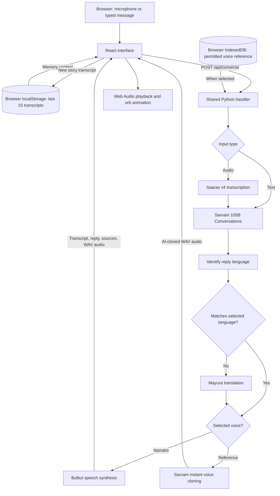

# Yaad — a voice time capsule powered by Sarvam AI

Tell a memory in your own language. Ask about it later. Hear the reply in the language you choose.

Yaad is a responsive hackathon prototype for preserving a familiar voice and using it to speak new stories, poems, and conversational replies. It combines Sarvam speech recognition, conversational AI, language identification, translation, and speech synthesis across dedicated Memories and Conversation pages, with an audio-reactive silver orb and a guided first-visit tutorial.

**[Open Yaad](https://yaad-ui.vercel.app/) · [Open the judge walkthrough](https://yaad-ui.vercel.app/?tour=1)**

> Current scope: the last 15 story transcripts are saved in the current browser. Yaad does not provide permanent story-audio archiving, accounts, or cross-device synchronization. Record a short, permitted voice reference through the orb for real Sarvam voice cloning. The app requires a saved voice before generating replies. Cloned output is labelled as AI-generated.

## Contents

- [What you can do](#what-you-can-do)
- [Judge walkthrough](#judge-walkthrough)
- [Architecture](#architecture)
- [Sarvam integrations and languages](#sarvam-integrations-and-languages)
- [Code structure](#code-structure)
- [Run locally](#run-locally)
- [API reference](#api-reference)
- [Deployment](#deployment)
- [Verification and troubleshooting](#verification-and-troubleshooting)
- [Data handling and limitations](#data-handling-and-limitations)
- [Attribution](#attribution)

## What you can do

- **Preserve a voice directly:** open Memories, confirm permission, and tap the silver orb. Speak clearly for 10–12 seconds; tap it again to save, or let it stop automatically. No file upload is needed.
- **Generate new content in that voice:** after saving, Yaad opens Conversation. Choose **Hear Twinkle, Twinkle**, type a request, or tap the orb to start hands-free conversation. Every reply uses the saved reference; incoming questions never replace it.
- **Choose a reply language:** input speech is detected automatically; the language selector controls generated text and speech across 11 supported languages.
- **Save stories separately:** choose **••• → Save a story**. Browse, delete, or ask about them from **••• → Saved stories**. These details stay off the main screen until opened.
- **Manage the saved voice:** **••• → Saved voice** lets you rename it, record a replacement, or remove it from this browser.
- **Use a focused interface:** the orb is the recording control. Replies show only the answer initially; request text and sources are behind **Details**. The interface adapts to phone, tablet, and laptop screens, with glass controls and smooth transitions.

## Judge walkthrough

Open **[the guided link](https://yaad-ui.vercel.app/?tour=1)**. The short first-visit guide explains the orb-based flow. Replay it from **••• → Quick guide**.

| Step | Action | Expected behavior |
| --- | --- | --- |
| 1 | Open **Memories**, then confirm permission to use the voice. | The page shows one recording orb; there is no file picker. |
| 2 | Tap the orb and speak naturally for 10–12 seconds. | The orb reacts to the microphone. Tap again to save; otherwise recording ends at 12 seconds. Clips shorter than 5 seconds or too quiet are rejected. |
| 3 | Wait for the transition to **Conversation**. | A local reference has been saved and is now the default for generated speech. Recording the reference itself does not call Sarvam. |
| 4 | Choose **Hear Twinkle, Twinkle**. | Sarvam generates the public-domain first stanza using the saved voice reference. This is new speech, not playback of the recording. |
| 5 | Tap headphones to replay, or tap the orb and request a different story. | A new request changes the content, while the saved reference stays the same. |
| 6 | Change the reply language and repeat a request. | Text and synthesized speech use the selected output language. |
| 7 | Reload the same browser and origin. | The voice reference remains available. |

Use your own voice or a voice you have permission and rights to clone. Cloning approximates a voice; it does not guarantee an identical reproduction or recreate the person's thoughts.

To test memory questions, choose **••• → Save a story** and submit this synthetic example:

> When I was eight, my grandfather taught me to ride a bicycle in Pune. We celebrated with mango ice cream.

Then visit Conversation and ask who taught you, where it happened, and what your grandfather's first salary was. Supported personal answers should reference the recorded story; an absent detail should be acknowledged as missing. Expand **Details** to inspect the supplied sources. These are expected behaviors to verify, not a guarantee of model accuracy.

On Conversation, the orb starts a hands-free session. A turn is sent after about 1.8 seconds of silence, then listening resumes after the reply. Each question is capped at 25 seconds. No detected speech ends listening after about 12 seconds; noisy rooms may require the keyboard alternative. Tap the orb again to end the session. During standalone playback, tapping the orb pauses the reply.

## Architecture



The frontend sends the current message, selected output language, mode, saved transcript context, and the saved voice reference to the backend. Conversation also sends up to eight recent user/assistant messages; these turns live in page memory, not durable storage. In **record** mode, the model acknowledges the story and asks one follow-up. In legacy **ask** mode, instructions restrict answers to supplied memories. The new **chat** mode supports general conversation while requiring supplied memories or prior turns for personal claims and requesting supporting memory IDs. **speak** is used for voice previews; it skips chat generation.

The backend checks that returned source IDs exist in the supplied archive. This is an ID check, not an independent verification that every claim is supported. The model can still make mistakes.

Generated replies are language-checked and translated when the detected language differs from the selection. Without a selected clone, speech synthesis first uses Bulbul v3, with a second attempt using Bulbul v4 Flash for configured languages or another v3 attempt otherwise. With a selected clone, the backend uses Sarvam instant voice cloning with the inline reference. It does not create a shared saved voice in the provider workspace. If synthesis fails, the text reply is still returned with a warning.

Locally, Vite forwards `/api` requests to the Python server. On Vercel, small Python function adapters reuse the same handler beside the static frontend.

### Technology stack

| Layer | Implementation |
| --- | --- |
| Interface | React 19, TypeScript, Vite 7, Lucide icons |
| Orb | Three.js, React Three Fiber, Drei, adapted ElevenLabs UI orb |
| Recording | Browser `getUserMedia` and `MediaRecorder` |
| Playback and audio levels | Web Audio API and analyser nodes |
| Styling | Custom CSS, translucent glass controls, responsive layouts |
| Backend | Python standard-library HTTP handler and official `sarvamai` SDK |
| Persistence | Transcripts in `localStorage`; one voice reference in IndexedDB; no application database |
| Hosting | Vercel static frontend and Python functions |

Voice capture is separate from question recording: the capture path normalizes and saves a reference in IndexedDB, while the question path sends audio for transcription without modifying that reference.

The interface does **not** call an ElevenLabs API. The orb is a visual component; Sarvam generates the responses and speech.

## Sarvam integrations and languages

| Purpose | SDK call | Model / behavior |
| --- | --- | --- |
| Speech recognition | `client.speech_to_text.transcribe` | `saaras:v4`, automatic input-language detection |
| Interviewing and memory questions | `client.chat.completions` | `sarvam-105b-conversations`, structured JSON response |
| Reply-language check | `client.text.identify_language` | Checks the generated reply's language |
| Conditional translation | `client.text.translate` | `mayura:v1`, native-script output |
| Cloned voice | `client.voice_cloning.convert` | Inline reference WAV; selected output language; no stock-voice fallback |
| Spoken reply | `client.text_to_speech.convert` | `bulbul:v3`, WAV output; configured fallback to `bulbul:v4-flash` |

The current output-language selector exposes:

| Language | Code | Language | Code |
| --- | --- | --- | --- |
| English | `en-IN` | Hindi | `hi-IN` |
| Marathi | `mr-IN` | Bengali | `bn-IN` |
| Tamil | `ta-IN` | Telugu | `te-IN` |
| Gujarati | `gu-IN` | Kannada | `kn-IN` |
| Malayalam | `ml-IN` | Punjabi | `pa-IN` |
| Odia | `od-IN` | | |

The v4 Flash fallback has configured voices for all of these except Malayalam and Odia, which retry v3. Input-language detection and output-language selection are separate: the selector does not force the language you must speak.

## Code structure

```text
Sarvam-Yaad/
├── src/
│   ├── main.tsx             # React entry point
│   ├── App.tsx              # Main screen, recording, requests, memories, playback
│   ├── GuidedTour.tsx       # Guided steps, spotlight positioning, keyboard handling
│   ├── VoicePanel.tsx       # Saved-voice naming, re-recording action and removal
│   ├── audio.ts             # Microphone-clip WAV normalization and IndexedDB storage
│   ├── Orb.tsx              # Audio-reactive Three.js orb
│   ├── style.css            # App layout, glass styling, responsive rules
│   ├── tour.css             # Tutorial overlay, transitions, reduced-motion styles
│   └── utils.ts             # Class-name utility
├── public/
│   ├── favicon.svg          # Simple typographic app mark
│   └── perlin-noise.png     # Bundled orb texture
├── api/
│   ├── converse.py          # Vercel adapter for the conversation handler
│   └── health.py            # Vercel adapter for the health handler
├── tests/
│   └── test_voice.py        # Offline validation, clone failure, and fallback tests
├── voice.py                # Reference validation and stock/cloned speech generation
├── server.py               # Shared API logic and local Python server
├── sarvam_check.py         # Standalone real chat API check
├── requirements.txt        # Python SDK dependency
├── package.json            # Frontend dependencies and scripts
├── package-lock.json       # Frontend dependency lockfile
├── vite.config.ts          # Dev server and local API proxy
├── tsconfig.json           # TypeScript configuration
├── index.html              # HTML entry point
├── vercel.json             # Build output and Python function configuration
├── .python-version         # Deployment Python version: 3.12
├── .env.example            # API-key variable template, no credential
├── .gitignore              # Excludes secrets, dependencies, build artifacts
├── .vercelignore           # Excludes local files from deployment uploads
├── ELEVENLABS-LICENSE.md    # License for the adapted orb component
└── README.md
```

### Where to make changes

- **User flow, language choices, memory handling, or playback:** start in [`src/App.tsx`](src/App.tsx). It owns the recording/request/playback states and browser persistence.
- **Tutorial copy and interaction:** edit [`src/GuidedTour.tsx`](src/GuidedTour.tsx), [`src/tour.css`](src/tour.css), and the corresponding `data-tour` targets in `App.tsx`.
- **Voice recording and storage:** edit [`src/VoicePanel.tsx`](src/VoicePanel.tsx) and [`src/audio.ts`](src/audio.ts). The orb starts browser recording in `App.tsx`; browser decoding normalizes the captured clip to a bounded mono 24 kHz PCM WAV before storage.
- **Layout or glass appearance:** edit [`src/style.css`](src/style.css). Orb rendering lives in [`src/Orb.tsx`](src/Orb.tsx).
- **Models, prompts, and language enforcement:** edit [`server.py`](server.py). Speech generation and voice-reference validation live in [`voice.py`](voice.py). Both local development and Vercel use this implementation.
- **Hosting settings:** edit [`vercel.json`](vercel.json). The adapters in `api/` contain no separate conversation workflow.

## Run locally

### Prerequisites

- Node.js **22.12 or newer** within a Vite-compatible release, and npm.
- Python **3.12** recommended to match deployment.
- A Sarvam API key with access and credits for the configured services.
- A modern browser with WebGL; microphone mode additionally requires recording support and permission.

### 1. Install dependencies

```bash
git clone https://github.com/Soham-commits/Sarvam-Yaad.git
cd Sarvam-Yaad
npm ci
python3 -m venv .venv
.venv/bin/python -m pip install -r requirements.txt
```

### 2. Configure the server key

For a fresh clone, copy the template:

```bash
cp .env.example .env
```

Open `.env` and fill in `SARVAM_API_KEY=` with your own key. Do not overwrite an existing `.env`. The backend also accepts an environment variable directly; an existing environment value takes precedence over the file.

Keep the key server-side. `.env` is ignored by Git; never place the key in React code or a `VITE_` variable, which would expose it in the browser bundle.

### 3. Start both servers

Terminal 1 — backend:

```bash
.venv/bin/python server.py
```

Terminal 2 — frontend:

```bash
npm run dev
```

Open **http://localhost:5173** and keep both terminals running. The backend listens at `127.0.0.1:8000`; Vite proxies `/api` to it.

On Windows, use `.venv\Scripts\python.exe` instead of `.venv/bin/python`, and `Copy-Item .env.example .env` in PowerShell instead of `cp`.

For a physical phone, use the deployed HTTPS app. An ordinary HTTP LAN address generally cannot access the microphone because browsers require a secure context; `localhost` is the local-development exception.

### Available commands

| Command | Purpose |
| --- | --- |
| `npm run dev` | Start the Vite development server with the API proxy |
| `npm run build` | Run TypeScript checking and produce the frontend in `dist/` |
| `npm run preview` | Preview the built static frontend; does **not** provide the development API proxy |
| `.venv/bin/python server.py` | Start the local backend |
| `.venv/bin/python sarvam_check.py` | Make one real chat request and print the reply |

The standalone check requires a configured key and consumes API usage. It verifies the chat integration only, not speech recognition, translation, or synthesis. Run the offline speech integration tests with `.venv/bin/python -m unittest discover -s tests -v`. These cover reference validation and mocked provider contracts; they do not verify live service availability or microphone behavior.

## API reference

### `GET /api/health`

Returns:

```json
{
  "ready": true,
  "model": "sarvam-105b-conversations"
}
```

This confirms that the handler loaded with a configured key. It does **not** contact Sarvam or verify key validity, model access, or remaining credits.

### `POST /api/converse`

Send JSON. This typed example asks about a synthetic supplied memory:

```json
{
  "mode": "ask",
  "language": "hi-IN",
  "text": "Where did I learn to ride a bicycle?",
  "memories": [
    {
      "id": "demo-memory-1",
      "text": "My grandfather taught me to ride a bicycle in Pune."
    }
  ]
}
```

| Field | Meaning |
| --- | --- |
| `mode` | `record` saves a story in the frontend; `chat` supports conversation; `speak` previews supplied text; legacy `ask` restricts answers to archive context. Defaults to `record`. |
| `language` | Output-language code from the supported list. Invalid values fall back to `en-IN`. |
| `text` | Typed input. A nonempty value takes precedence over audio; limited to 3,000 characters. |
| `audio` | Base64-encoded audio bytes, without a data-URL prefix, when not supplying text. |
| `mime` | Recording MIME type, such as `audio/webm` or `audio/mp4`. |
| `history` | Optional recent `{role, content}` turns for `chat`. Only user/assistant roles are accepted; the last eight are used. |
| `voice` | Optional `{name, audio, consent: true}` for a clone. `audio` is base64 mono 16-bit PCM WAV, 5–15 seconds. The frontend normalizes the orb recording; the server validates it. Omit for the stock narrator. |
| `memories` | Array of `{id, text}` objects. The handler uses the last 15 and bounds the prompt context. |

Successful responses contain:

| Field | Meaning |
| --- | --- |
| `transcript` | Recognized speech or submitted text |
| `reply` | Generated answer in the selected output language |
| `audio` | Base64 WAV speech, or `null` when speech generation fails |
| `sources` | Supporting memory IDs returned by the model and filtered against supplied IDs |
| `warning` | Speech-generation warning, or `null` |
| `voice` | Narrator label or selected reference name with an AI-clone label |
| `language` | Output-language code |
| `elapsed` | Backend processing time in seconds |

The frontend alone persists new stories; posting `record` directly to the API does not save anything on a server. Replies are bounded to 1,000 characters for clone compatibility. Recognized English requests to recite Twinkle, Twinkle use the original first stanza directly, then follow the same language and speech pipeline. Other content requests use the conversational model.

The handler limits incoming request bodies to 12,000,000 bytes; the browser caps voice-reference capture at 12 seconds and message recording at 25 seconds. Hosting-platform limits can be lower. Empty input and unrecognized speech have error responses; upstream failures generally return HTTP `502` with an `error` message. Speech-synthesis failure alone can return HTTP `200` with text and a warning, so clients should inspect both `audio` and `warning`.

## Deployment

The app is configured for Vercel:

1. Import this repository into a Vercel project.
2. Add **`SARVAM_API_KEY`** in the project's server environment variables for the environments you use. Do not upload a local `.env` or commit a key.
3. Use the repository's configuration: Vite framework, `npm run build`, and `dist` output.
4. Deploy. If changing environment variables afterward, redeploy to apply them.
5. Open the HTTPS URL and complete the voice and typed checks below.

[`vercel.json`](vercel.json) configures the Python functions with a 60-second maximum duration. The full voice pipeline makes several upstream calls, so processing time depends on Sarvam and platform limits; no latency guarantee is made.

The existing live project is connected to GitHub `main` for production deployments. The local Python process is not needed by the deployed site. For a new deployment, browser memories start empty because storage is scoped to the site's origin.

## Verification and troubleshooting

### Manual checks

Before sharing a deployment, check the actual user flow:

- Open `?tour=1`; verify the four short guide steps and their highlighted controls.
- Confirm permission, record through the orb, and verify automatic navigation to Conversation.
- From the more menu, save a typed story; confirm a reply and persistence after reload.
- Record a story; verify the transcript, audio playback, and orb response.
- Ask a question with a known answer and inspect **Original memory**.
- Ask for an absent detail; confirm the reply acknowledges the gap.
- Change output language while keeping input in another language; check text **and** speech.
- Pause/replay audio; try the visible **Play answer** control on a phone.
- Record a permitted reference through the orb, generate a poem, reload, and verify the same reference remains the default.
- Confirm a missing-permission or invalid-duration reference is rejected, and a failed clone does not switch narrators.
- Check narrow phone, tablet, and laptop layouts; confirm controls remain usable.
- Clear test memories from the more menu after testing.

### Common issues

| Symptom | What to check |
| --- | --- |
| Microphone does not open | Use HTTPS or localhost, allow browser/OS microphone access, and check recording support. Use the typed alternative if needed. |
| Reply text appears without sound | Tap **Play answer**, check device volume/output, and inspect any speech-service warning. Browser autoplay restrictions may require a tap. |
| No reply or an API error | Check backend availability, Sarvam model access (including instant voice cloning when selected), credits, and server-side key configuration. A successful health response alone is insufficient. |
| Local `/api` calls fail | Keep the Python server running on port 8000 and use the Vite development server on port 5173. Static preview does not include the dev proxy. |
| Memories are missing on another device or URL | Transcripts belong to the current browser and origin. Localhost, the deployed domain, private browsing, and other devices have separate storage. |
| Tutorial no longer opens automatically | Use `?tour=1` or **••• → Quick guide**. The current first-visit marker is `yaad-guided-tour-v3`. |
| A reply takes too long | Retry with a shorter recording or typed input. The browser waits up to 120 seconds, but deployment function limits may expire sooner. |

## Data handling and limitations

- **Browser persistence:** `yaad-memories` holds up to 15 story transcripts in `localStorage`. Clearing site data or using another browser can remove or separate access to them. There is no backup or synchronization service.
- **External processing:** audio, current text, recent conversation, any selected voice reference, and supplied memory context are sent through the backend to Sarvam as needed to fulfill the request. Browser-local storage does not mean processing happens entirely on-device.
- **Audio scope:** original story recordings are not durably archived. Generated replies are held temporarily in the page and can be downloaded. A deliberately recorded voice reference is stored separately in browser IndexedDB (`yaad-voices`); remove it from **••• → Saved voice** to delete that local copy.
- **Narrator identity:** record a voice you have permission and rights to use; the app uses that saved recording for all generated replies. Cloning generates new speech with a similar sound; it does not recover that person's thoughts or memories, and the conversational model is instructed not to impersonate them. The reference is sent inline to Sarvam when used. Deleting it locally does not control provider-side request retention; consult provider terms.
- **Answer reliability:** prompt instructions and source-ID filtering support grounded answers but cannot eliminate incorrect statements. Transcription and language identification can also be wrong.
- **Public-demo scope:** there are no application accounts, server-side user archives, access controls, or app-level rate limiting. Public requests use the deployment owner's Sarvam account and credits. Add these controls before broader production use.
- **Connectivity:** generation requires internet access and available upstream services. This is a working prototype, not a production archival service.

## Attribution

The orb in [`src/Orb.tsx`](src/Orb.tsx) is adapted from the [ElevenLabs UI](https://github.com/elevenlabs/ui) component, with a silver palette and bundled texture. Its MIT license is retained in [`ELEVENLABS-LICENSE.md`](ELEVENLABS-LICENSE.md). This attribution does not declare a repository-wide license for the rest of Yaad.

AI processing uses the official Sarvam SDK. See the [Sarvam documentation](https://docs.sarvam.ai/api/getting-started/welcome) for service access and API details. Supported models and behavior documented above reflect the implementation in this repository.
