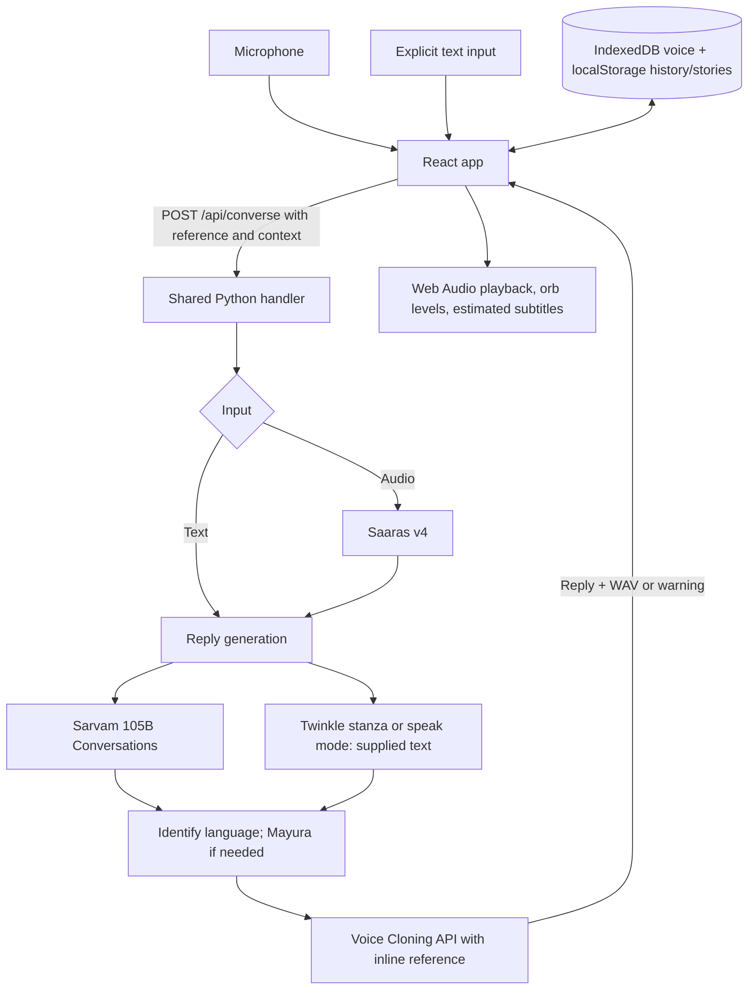

# Architecture and API

[Project guide](../README.md)

## Request flow

The UI always supplies a saved voice. API-only callers may omit it, which uses Bulbul v3 and a configured v4 Flash retry instead. A failed clone never falls back to a stock narrator.

## Frontend

`App.tsx` owns recording, requests, active context, and playback. States are idle, connecting, listening, thinking, talking, and ready; these are internal states, not a top-right status label.

- **Enrollment:** permission confirmation → orb microphone capture → mono 24 kHz, 16-bit PCM WAV → IndexedDB. Capture stops at 12 seconds; clips under 5 seconds or too quiet are rejected.
- **Conversation:** subsequent recordings do not replace the reference. Hands-free sends after roughly 1.8 seconds of silence and resumes after playback; messages are capped at 25 active recording seconds. Mute pauses recording. End stops the interaction.
- **Playback:** decoded WAV runs through Web Audio and analyser nodes. Levels drive the orb. Subtitles estimate word/chunk timing from playback progress; this is not provider timestamp alignment or token streaming. Sustained frame pressure switches captions to plain text; reduced motion is respected.
- **Navigation:** Yaad at top left, circular menu at top right, one main voice CTA below. Menu close collapses the ring and returns the trigger to the header position. Secondary features live in drawer panels; typing opens only on request.
- **Viewport:** fixed main screen with mobile safe areas and visual-viewport sizing. Secondary lists can scroll internally. Legacy `/memories` and `/conversation` routes normalize to `/`.

### Browser storage

| Store | Contents |
| --- | --- |
| IndexedDB `yaad-voices`, `profiles` store, `reference` key | One permitted voice reference and name |
| localStorage `yaad-memories` | Last 15 story transcripts |
| localStorage `yaad-history-v1` | Last 40 conversation messages |
| localStorage settings | Reply language, subtitles, hands-free |
| localStorage `yaad-guided-tour-v4` | First-visit tutorial completion |

Only the last eight active conversation turns are sent as chat history. New conversation clears active context/playback while retaining saved data. Clearing site data removes browser persistence. No application database is used.

## Backend

`server.py` implements both local HTTP handling and the workflow reused by `api/converse.py` and `api/health.py` on Vercel. `voice.py` validates references and synthesizes speech. Credentials load from `SARVAM_API_KEY` in the environment, then the ignored `.env` file.

1. Validate request and optional reference.
2. Transcribe audio if nonempty typed input is absent.
3. Generate a JSON reply and supporting memory IDs using the mode's prompt. General conversation must not invent family history or claim to be the voice owner.
4. Check reply language; translate to the selection when needed.
5. Filter source IDs to those present in supplied memories. This does not independently verify claims.
6. Synthesize with the inline voice reference and return text/audio. Clone failure returns a warning and no audio.

The one-tap Twinkle demo uses the public-domain first stanza directly, then the same language/speech stages. `speak` also skips chat generation. Neither path should be described as model-generated poem text.

## HTTP contract

### `GET /api/health`

Returns `{"ready":true,"model":"sarvam-105b-conversations"}` when the configured handler loads. It does not call Sarvam or verify key validity, access, or credits.

### `POST /api/converse`

JSON fields:

| Field | Contract |
| --- | --- |
| `mode` | `chat` for conversation, `record` for story follow-up, `speak` for supplied text, legacy `ask` for archive-only questions. Default: `record`. Persistence remains frontend-owned. |
| `language` | Selected output code; unsupported values use `en-IN`. Supported choices are in `src/Drawer.tsx` and validated in `server.py`. |
| `text` | Typed input, up to 3,000 characters; takes precedence over audio |
| `audio`, `mime` | Base64 recording without data-URL prefix and its MIME type |
| `voice` | `{name, audio, consent:true}`; base64 mono 16-bit PCM WAV, 5–15 seconds; encoded value at most 1,000,000 characters |
| `memories` | Last 15 `{id,text}` entries; bounded prompt context |
| `history` | Last eight valid user/assistant `{role,content}` turns, used by `chat` |

Success includes `transcript`, `reply`, `audio` (base64 WAV or null), `sources` (filtered IDs), `warning`, `language`, `voice`, and `elapsed` (seconds). Replies are bounded to 1,000 characters. Clients must inspect `audio` and `warning` even on HTTP 200.

Invalid JSON/reference returns 400, oversized or missing request bodies return 413, and no recognized speech returns 422. Upstream errors generally map to 502 with a friendly `error`. The handler's body limit is 12 MB; hosting limits can be lower.

## Runtime and verification

- Local: Vite on 5173 proxies `/api` to Python on `127.0.0.1:8000`.
- Production: Vercel serves `dist` and Python functions, configured for up to 60 seconds. GitHub `main` triggers production builds. Local processes are not required.
- `npm run build` checks TypeScript and bundles the interface. `tests/test_voice.py` checks reference validation, clone contracts/failure, and narrator fallback using mocks.
- Live microphone, provider access, cloning quality, and physical-device behavior require separate end-to-end checks. The standalone chat check covers chat only.

The prototype has no account system, server persistence, authentication, or app-level rate limiting. Browser-local storage is not an offline-processing guarantee: relevant recordings, references, and context are sent to Sarvam.
